# Experiment Report: showcase_20etf_ridge_rar5d_top5_rt30_rb5

- **Period:** 2013-01-01 to 2024-12-31
- **Universe:** SPY, QQQ, IWM, EFA, EEM, TLT, IEF, AGG, HYG, LQD, GLD, DBC, VNQ, XLK, XLF, XLE, XLV, XLI, XLP, XLU
- **Sharpe ratio:** 0.6932

## Research Thesis & Methodology

**Hypothesis:** A shared RidgeRegression model predicts cross-sectional return ranks across the 20-asset universe using 15 engineered features applied independently to each asset. The top-ranked assets by predicted score, held equal-weight, earn a 5-day forward return edge over the universe after transaction costs.

**Feature rationale:**

- **`mom_5`** (window: 5): Trailing-return momentum captures the continuation of recent price trends — a well-documented persistent anomaly attributed to investor underreaction and gradual information diffusion.
- **`vol_21`** (window: 21): Rolling realised volatility characterises the current market regime: elevated volatility signals risk-off environments where expected returns and risk premia shift materially.
- **`zscore_20`** (window: 20): Rolling z-score normalisation transforms raw signals into a stationary, mean-zero representation, mitigating regime-level drift that would otherwise confound the model's cross-period comparisons.
- **`trend_20`** (window: 20): Trend strength (slope R²) quantifies how consistently directional a price series has been — distinguishing sustained trends from noisy mean-reverting behaviour.
- **`trend_persist_20d`** (window: 20): Trend persistence measures the fraction of trading days within the window on which the asset's daily return was positive — a directional hit rate. Unlike raw momentum (which measures magnitude) or trend strength (which measures linearity), this captures how *consistently* each day contributed to the trend direction, exposing the noise structure within the momentum window.
- **`breakout_63d`** (window: 63): Breakout strength measures the proximity of the current price to its rolling N-period high: (price / rolling_max) − 1. A value near zero indicates the asset is at or near its recent range top — the breakout regime. Large negative values indicate the asset is well below its recent high. The model can learn whether proximity to recent highs signals continuation (momentum) or resistance (mean-reversion), a relationship that reverses across macro regimes.
- **`drawdown_dist_252d`** (window: 252): Drawdown distance measures the current price's percentage decline from its rolling N-period peak: (price / rolling_max) − 1 over a long lookback window. Unlike short-horizon breakout strength, this captures sustained stress-state positioning — whether an asset remains in an extended drawdown relative to its annual price history. Assets with large negative values are in prolonged underperformance regimes; values near zero indicate the asset is near or recovering to its annual high-water mark.
- **`vol_compress_21_63`**: Volatility compression measures the ratio of short-term to long-term realised volatility. A ratio below 1.0 indicates a compressed-vol regime — recent realised vol has contracted relative to its medium-term baseline. This is a breakout precursor indicator: periods of sustained vol compression historically precede regime transitions. A ratio above 1.0 indicates vol expansion, consistent with an active stress or dislocation environment.
- **`beta_60d`** (window: 60): Rolling market beta measures each asset's time-varying sensitivity to the market reference (SPY): Cov(r_asset, r_market) / Var(r_market) over a rolling window. In a cross-sectional ranking framework, beta captures which assets are currently high-beta (amplified systematic exposure) vs defensive (low-beta) — information that is orthogonal to price-history momentum and directly relevant to regime positioning. A model learning positive beta coefficients is selecting high-beta assets in trending markets; negative coefficients indicate a preference for defensives.
- **`sharpe_mom_63d`** (window: 63): Risk-adjusted momentum divides the trailing N-period return by rolling realised volatility — a Sharpe-like signal measuring momentum quality rather than raw magnitude. Two assets with equal 12-month momentum but different volatilities receive different scores: the lower-vol asset achieves its return more efficiently. This exposes whether the model rewards momentum consistency (efficient uptrends) or raw return regardless of the risk taken to achieve it.

**Label construction:** `risk_adjusted_ranking_target` with 5-period horizon. Cross-sectional risk-adjusted rank labels divide each asset's forward return by its realised forward volatility before ranking. This targets assets that outperform on a Sharpe-like basis rather than by raw return, penalising high-return assets that achieved their gains through disproportionate volatility. Assets with zero realised volatility over the horizon are excluded from ranking on that date.

**Model choice:** Ridge regression (L2 regularisation) is the natural baseline for financial ML: it is interpretable, computationally stable, and its regularisation controls overfitting in the high-noise, low signal-to-noise regime of asset returns without eliminating features entirely.

| Hyperparameter | Value |
| --- | --- |
| alpha | 1.0 |

**Signal translation:** The top-N signal selects the N assets with the highest predictions at each rebalance, enabling cross-sectional portfolio construction from multi-asset prediction outputs.

**Key risks and limitations:**

- *Low signal-to-noise ratio* — Asset return prediction is a notoriously difficult task. Even a statistically significant in-sample fit does not guarantee that the signal survives out-of-sample in a different market regime.
- *Regime non-stationarity* — Feature-return relationships that held during the training window may weaken or reverse in different macro environments. Walk-forward validation tests chronological robustness but cannot fully simulate live deployment.
- *Overfitting risk* — With a limited sample and multiple features, regularisation is essential. Coefficient stability across walk-forward splits is a key diagnostic for detecting overfitting.
- *Transaction costs* — ML signals can produce frequent position changes. Cost drag compounds at high turnover; the model's net alpha must comfortably exceed the cost of executing its predicted positions.

**Scope:** This investigation is a systematic demonstration of the full ML research process: feature engineering, leakage-safe alignment, regularised model training, walk-forward validation, and signal translation. *The methodology is the product.*

## Universe Construction & Coverage

The research universe comprises 20 institutional ETFs spanning US equities (SPY, QQQ, IWM), international equities (EEM), rates (TLT, IEF, AGG), commodities (GLD, DBC), sectors (XLK, XLF, XLE, XLV, XLI, XLP), and credit (HYG, LQD). The panel covers 3,020 trading days (2013-01-02 to 2024-12-31), providing a structurally diverse cross-sectional environment for regime-heterogeneous research.

**Asset coverage summary:**

| Asset | Trading Days | First Date | Last Date | Missingness | Mean Ann. Vol |
| --- | --- | --- | --- | --- | --- |
| SPY | 3020 | 2013-01-02 | 2024-12-31 | 0.0% | 14.8% |
| QQQ | 3020 | 2013-01-02 | 2024-12-31 | 0.0% | 18.7% |
| IWM | 3020 | 2013-01-02 | 2024-12-31 | 0.0% | 19.7% |
| EFA | 3020 | 2013-01-02 | 2024-12-31 | 0.0% | 15.4% |
| EEM | 3020 | 2013-01-02 | 2024-12-31 | 0.0% | 19.0% |
| TLT | 3020 | 2013-01-02 | 2024-12-31 | 0.0% | 14.0% |
| IEF | 3020 | 2013-01-02 | 2024-12-31 | 0.0% | 6.2% |
| AGG | 3020 | 2013-01-02 | 2024-12-31 | 0.0% | 4.4% |
| HYG | 3020 | 2013-01-02 | 2024-12-31 | 0.0% | 6.9% |
| LQD | 3020 | 2013-01-02 | 2024-12-31 | 0.0% | 6.9% |
| GLD | 3020 | 2013-01-02 | 2024-12-31 | 0.0% | 14.3% |
| DBC | 3020 | 2013-01-02 | 2024-12-31 | 0.0% | 16.0% |
| VNQ | 3020 | 2013-01-02 | 2024-12-31 | 0.0% | 17.5% |
| XLK | 3020 | 2013-01-02 | 2024-12-31 | 0.0% | 19.5% |
| XLF | 3020 | 2013-01-02 | 2024-12-31 | 0.0% | 18.6% |
| XLE | 3020 | 2013-01-02 | 2024-12-31 | 0.0% | 24.6% |
| XLV | 3020 | 2013-01-02 | 2024-12-31 | 0.0% | 14.9% |
| XLI | 3020 | 2013-01-02 | 2024-12-31 | 0.0% | 16.7% |
| XLP | 3020 | 2013-01-02 | 2024-12-31 | 0.0% | 12.7% |
| XLU | 3020 | 2013-01-02 | 2024-12-31 | 0.0% | 16.3% |

**Cross-asset correlation structure:**

Mean pairwise correlation 0.38. Highest: QQQ/XLK (0.97) — structural co-movement. Lowest: TLT/XLF (-0.33) — regime diversification. Orthogonal asset pairs preserve cross-sectional signal breadth under correlated stress scenarios.

**Universe integrity:**

All 20 assets have complete coverage across all 3,020 trading days (2013-01-02 – 2024-12-31). Missingness: 0.0% for every asset. No structural gaps, delistings, or duplicate timestamps detected. Universe breadth is structurally stable throughout the backtest period.

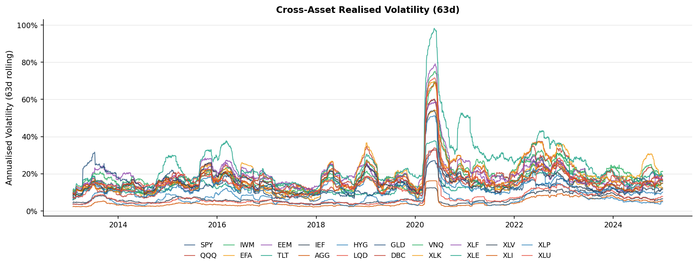

*63-day rolling annualised volatility by asset. Persistent divergence between risk-on and risk-off assets confirms macro regime heterogeneity. Synchronised spikes identify systemic stress episodes.*

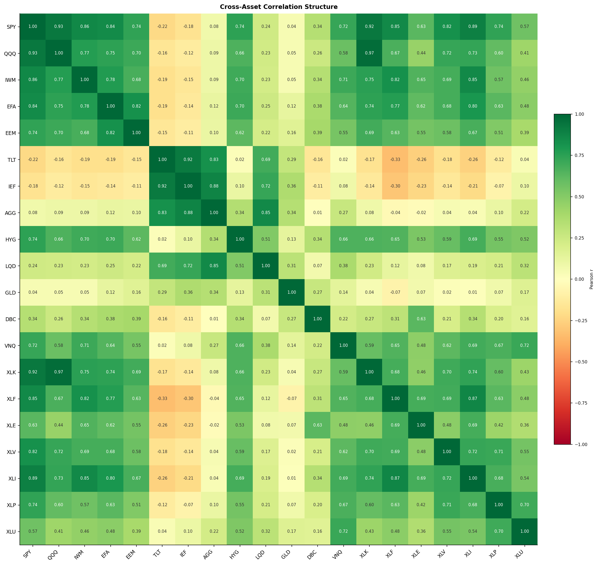

*Full-period pairwise return correlation matrix. Correlated clusters (e.g. SPY/QQQ/XLK) reduce effective breadth; low or negative correlations (e.g. TLT, GLD vs equities) confirm regime diversification.*

## Data Infrastructure

**Data source:** Yahoo Finance daily OHLCV data, ingested via `yfinance` and persisted to local Parquet files for reproducibility. All prices are adjusted closing prices.

**Alignment policy:** Inner join across all universe constituents — only trading days on which every asset has a valid price are retained. This eliminates NaN-driven look-ahead in cross-sectional ranking.

**Missing value policy:** Forward-fill up to a configurable limit (default: 5 trading days) for isolated gaps caused by exchange holidays or data vendor gaps. Gaps exceeding the limit remain NaN and are surfaced in diagnostics rather than silently filled. Over-cleaning (excessive interpolation) introduces bias by smoothing market structure.

**Coverage:** 3020 trading days from 2013-01-02 to 2024-12-31 across 20 assets.

| Asset | NaN Count | Ann. Return | Ann. Volatility |
| --- | --- | --- | --- |
| SPY | 0 | 13.0% | 16.8% |
| QQQ | 0 | 19.1% | 20.6% |
| IWM | 0 | 10.1% | 21.5% |
| EFA | 0 | 3.7% | 16.8% |
| EEM | 0 | 1.4% | 20.2% |
| TLT | 0 | -1.5% | 14.8% |
| IEF | 0 | -1.0% | 6.6% |
| AGG | 0 | -1.0% | 5.1% |
| HYG | 0 | -1.2% | 8.3% |
| LQD | 0 | -0.7% | 8.2% |
| GLD | 0 | 4.4% | 15.0% |
| DBC | 0 | -0.8% | 17.0% |
| VNQ | 0 | 4.4% | 19.8% |
| XLK | 0 | 19.5% | 21.8% |
| XLF | 0 | 12.7% | 21.0% |
| XLE | 0 | 5.3% | 28.1% |
| XLV | 0 | 11.5% | 16.3% |
| XLI | 0 | 12.0% | 18.8% |
| XLP | 0 | 7.6% | 14.1% |
| XLU | 0 | 8.0% | 18.4% |

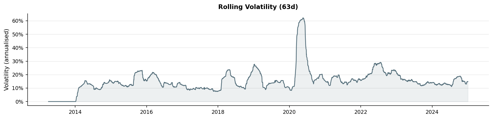

*63-day realised volatility. Elevated regimes and spikes contextualise coefficient instability, feature drift, and drawdown episodes below.*

## Feature Engineering

The 20-asset aligned price panel is transformed into a structured feature space. Each feature operationalises a specific hypothesis about the information content embedded in price time series — momentum persistence, volatility clustering, or trend strength. All features are constructed as pure functions of historical prices, ensuring no look-ahead contamination at the feature generation stage.

**Feature registry** — 15 features applied independently to each of the 20 universe assets:

| Name | Family | Transform | Window | Normalisation |
| --- | --- | --- | --- | --- |
| 5D Momentum | Trend | trailing_return | 5 | raw |
| 20D Momentum | Trend | trailing_return | 20 | raw |
| 60D Momentum | Trend | trailing_return | 60 | raw |
| 252D Momentum | Trend | trailing_return | 252 | raw |
| 21D Realized Volatility | Volatility | rolling_std_annualised | 21 | raw |
| 20D Z-Score | Mean-Reversion | rolling_zscore | 20 | zscore |
| 20D Trend Strength | Trend | slope_r2 | 20 | raw |
| 20D Trend Persistence | Trend | rolling_pos_day_fraction | 20 | raw |
| 63D Breakout Strength | Trend | price_vs_rolling_high | 63 | raw |
| 252D Drawdown Distance | Mean-Reversion | price_vs_rolling_peak | 252 | raw |
| Vol Compression (21/63D) | Volatility | short_long_vol_ratio | — | raw |
| 60D Market Beta | Market Structure | rolling_cov_over_var | 60 | raw |
| 63D Risk-Adj Momentum | Trend | momentum_over_vol | 63 | raw |
| 126D Risk-Adj Momentum | Trend | momentum_over_vol | 126 | raw |
| 252D Risk-Adj Momentum | Trend | momentum_over_vol | 252 | raw |

*Rolling z-score features are normalised in-place: mean and standard deviation are estimated over a rolling window centred at time t−1. This ensures normalisation parameters are derived from past data only, preserving the leakage-free property.*

**Label construction:**

| Parameter | Value |
| --- | --- |
| Label type | `risk_adjusted_ranking_target` |
| Horizon | 5 trading days |

**Sample construction and alignment:**

| Stage | Count / Value |
| --- | --- |
| Raw price observations (per asset) | 3020 |
| Warm-up rows removed (feature NaN) | 252 |
| Label rows removed (forward horizon NaN) | 5 |
| Aligned trading days per asset | 2763 |
| Pre-alignment pooled panel size (estimated) | 55,260  (2763 days × 20 assets) |
| Total alignment loss | 8.5% |
| Effective sample range | 2014-01-02 to 2024-12-23 |

*Warm-up and label rows are counted per asset. The pooled model trains on all (date, asset) pairs simultaneously — one shared Ridge model fitted on all pooled observations. Alignment loss is computed as the fraction of per-asset trading days removed;* *the pooled sample size is proportionally larger.*

**Per-feature statistics (pooled across all universe assets):**

| Feature | Mean | Std | Skew | AR(1) | Coverage |
| --- | --- | --- | --- | --- | --- |
| 5D Momentum | 0.0012 | 0.0236 | -0.53 | 0.792 | 100.0% |
| 20D Momentum | 0.0050 | 0.0458 | -0.72 | 0.942 | 100.0% |
| 60D Momentum | 0.0149 | 0.0751 | -0.15 | 0.977 | 100.0% |
| 252D Momentum | 0.0616 | 0.1681 | 0.76 | 0.994 | 100.0% |
| 21D Realized Volatility | 0.1446 | 0.0983 | 3.68 | 0.994 | 100.0% |
| 20D Z-Score | 0.1623 | 1.2968 | -0.30 | 0.871 | 100.0% |
| 20D Trend Strength | 0.1112 | 0.6580 | -0.22 | 0.984 | 100.0% |
| 20D Trend Persistence | 0.5268 | 0.1089 | -0.05 | 0.947 | 100.0% |
| 63D Breakout Strength | -0.0395 | 0.0478 | -2.59 | 0.979 | 100.0% |
| 252D Drawdown Distance | -0.0708 | 0.0757 | -1.77 | 0.992 | 100.0% |
| Vol Compression (21/63D) | 0.9797 | 0.2171 | 0.18 | 0.971 | 100.0% |
| 60D Market Beta | 0.6190 | 0.5120 | -0.31 | 0.999 | 100.0% |
| 63D Risk-Adj Momentum | 0.1399 | 0.4793 | 0.07 | 0.979 | 100.0% |
| 126D Risk-Adj Momentum | 0.2667 | 0.6994 | 0.20 | 0.988 | 100.0% |
| 252D Risk-Adj Momentum | 0.4912 | 1.1197 | 0.51 | 0.994 | 100.0% |

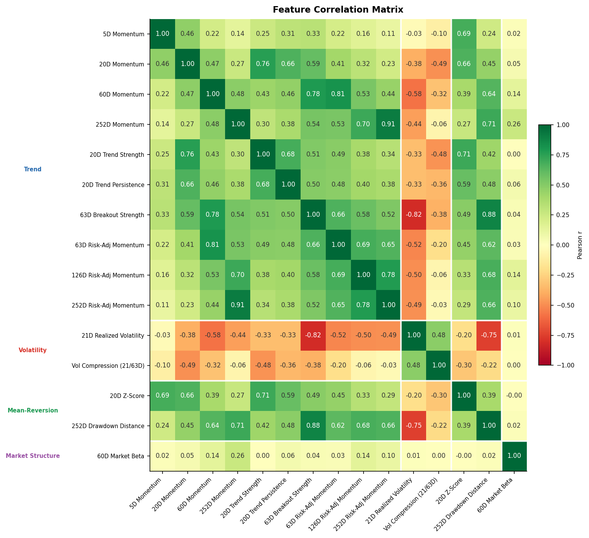

*Pairwise feature correlations. Correlated clusters reduce effective dimensionality; Ridge regularisation partially mitigates collinearity but reduces coefficient interpretability.*

**Feature family grouping:**

| Family | Features | Hypothesis |
| --- | --- | --- |
| Trend | 5D Momentum, 20D Momentum, 60D Momentum, 252D Momentum, 20D Trend Strength, 20D Trend Persistence, 63D Breakout Strength, 63D Risk-Adj Momentum, 126D Risk-Adj Momentum, 252D Risk-Adj Momentum | Directional momentum and price-continuation signals. Positive IC in trending regimes; may … |
| Volatility | 21D Realized Volatility, Vol Compression (21/63D) | Risk-regime indicators capturing realised and implied volatility structure. Tend to be neg… |
| Mean-Reversion | 20D Z-Score, 252D Drawdown Distance | Price normalisation and short-horizon reversion pressure. Effective when markets are range… |
| Market Structure | 60D Market Beta | Systematic risk exposure and cross-asset sensitivity dynamics. Rolling beta captures time-… |

This experiment deploys 15 features across 4 canonical families. Each family operationalises a distinct market hypothesis; orthogonal families provide diversified information sources, reducing model dependence on any single regime hypothesis.

## Backtesting Methodology

All backtests use a strictly vectorized, look-ahead-safe execution framework. The critical invariant: no information from period *t* enters the position that earns the return of period *t*.

**Timing convention:**

| Step | Action | When |
| --- | --- | --- |
| Signal computed | Momentum scores calculated from all prices ≤ day *t* | Close of day *t* |
| Position entered | Computed weights applied to portfolio | Open of day *t+1* |
| Return realized | Portfolio return earned | Close of day *t+1* |

**Implementation:** `applied_weights = weights.shift(1)`. The strategy never observes the return it will receive when deciding to trade. The first row of every backtest has a zero position — the portfolio is flat until the first valid signal propagates through the one-day lag.

**Portfolio return computation per period:**

```
gross_return_t  = sum_i( weight_{i,t-1} * asset_return_{i,t} )
transaction_cost_t = sum_i( |weight_{i,t} - weight_{i,t-1}| ) * (5 / 10_000)
net_return_t    = gross_return_t - transaction_cost_t
equity_curve_t  = product_{s<=t}( 1 + net_return_s ),  anchored at 1.0
drawdown_t      = ( equity_t - max_{s<=t} equity_s ) / max_{s<=t} equity_s
```

**Transaction cost model:** One-way costs of 5 bps are applied to each unit of absolute portfolio weight change. Cost is incurred only on actual weight changes — during forward-fill periods between rebalances, weights are unchanged and no cost is deducted.

**Turnover definition:** Daily turnover = sum of absolute weight changes across all assets per period. High mean daily turnover implies high transaction cost drag; the cost model above makes this drag explicit.

## Portfolio Construction Process

**Research configuration:**

| Parameter | Value |
| --- | --- |
| Training Window | 48 months (rolling) |
| Forecast Horizon | 5 trading days |
| Retrain Frequency | 30 trading days |
| Rebalance Frequency | 5 trading days |

The model uses a rolling 48-month training window, 5-day forward horizon, retrained every 30 trading days and portfolios rebalanced every 5 trading days.

**Signal-to-portfolio pipeline for `RidgeRegression` (panel cross-sectional):**

```
prices[t-window : t]
  → feature_matrix('mom_5', 'mom_20', 'mom_60', 'mom_252', ... (15 total))
       (X: 15 columns, no NaN rows, pre-alignment)
  → RidgeRegression.predict(X_clean)
       (raw score: expected risk adjusted ranking target)
  → signal_fn(predictions)   [top_n]
       weight_t = 1/top_n for top-N assets by prediction (cross-sectional)
  → forward_fill to daily index
  → shift(1)   [look-ahead prevention]
  → weights applied in portfolio backtest engine
```

**Leakage-prevention:** The `shift(1)` operation ensures that the weight active on trading day *t* was computed from information available only up to close of day *t−1*. The first valid signal enters the portfolio on the trading day following the first non-NaN prediction.

**Transaction cost model:** Costs are applied to every unit of absolute weight change per period. The model's net alpha must exceed the cost drag implied by its turnover to be viable in a live deployment.

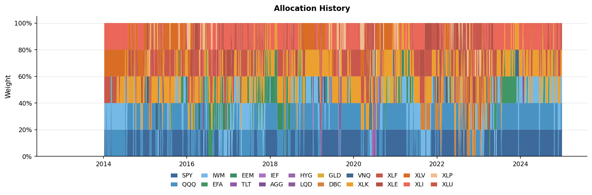

*Stacked allocation through time — which assets the model holds each period. Persistent concentration in one asset reveals ranking stability or regime lock-in. Rapid composition turnover (frequent colour transitions) coincides with regimes where cross-sectional scores are tightly clustered and small feature changes alter the ranking. Defensive migration (TLT/GLD dominance) marks risk-off transitions. Periods of equity breadth (multiple equity ETFs held) indicate low-dispersion regimes where the model distributes exposure broadly.*

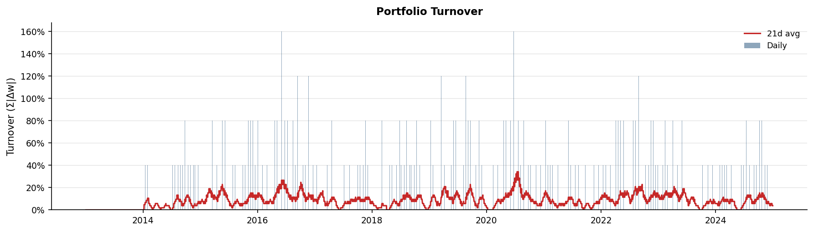

*Portfolio turnover quantifies daily weight change magnitude — the primary determinant of transaction cost drag. Periods of elevated turnover reduce net returns through friction. Turnover spikes that coincide with drawdown periods indicate cost-exacerbated losses: the signal is reversing precisely when it is most expensive to act on, amplifying rather than merely reducing performance.*

## Allocation Research

**Allocation policy:** equal-weight (1/k per selected asset).

**Concentration summary:**

| Metric | Value |
| --- | --- |
| Mean HHI (Σwᵢ²) | 0.2000 |
| Mean effective breadth (1/HHI) | 5.00 |
| Entropy effective N (exp(H)) | 5.00 |
| Mean assets held | 5.0 (max 5) |
| Mean max weight per period | 0.200 |

Allocation is broadly diversified (mean HHI 0.200, effective N ≈ 5.0 implied bets). The model's cross-sectional scores produce near-uniform weights across the selected basket, limiting concentration risk but also reducing the incremental value of confidence-weighted allocation over simple equal-weighting.


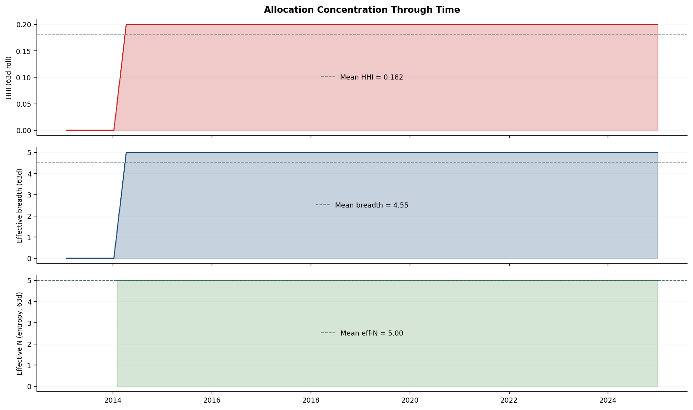

*HHI (top), effective breadth (middle), and entropy effective-N (bottom) through time. Elevated HHI with depressed breadth identifies concentration regimes; periods where effective-N approaches the basket size confirm near-uniform allocation. The 63-day rolling mean smooths short-term rebalance noise to reveal structural regime transitions.*

**Prediction dispersion:**

Mean cross-sectional prediction σ = 0.0204; mean top-minus-bottom spread = 0.0694. Low σ identifies score-compression regimes where ranking information is minimal; near-zero spread indicates ranking indifference.


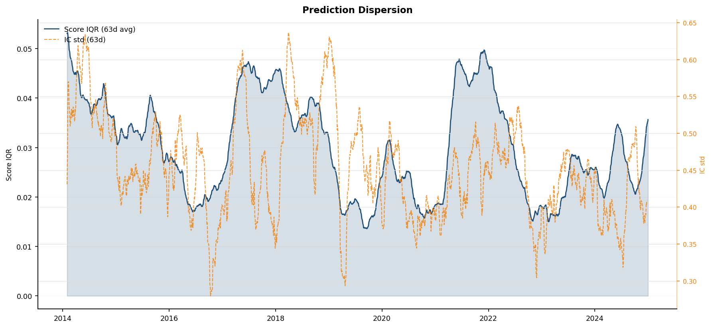

*Rolling 63-day cross-sectional prediction standard deviation (top) and top-minus-bottom score spread (bottom). Score compression periods (depressed σ) indicate regimes where model confidence is uniformly low and cross-sectional differentiation carries little economic signal. Near-zero spread regimes are especially problematic for confidence-weighted allocation schemes.*

**Confidence calibration:**

Confidence calibration is **non-monotonic** (top-minus-bottom spread +0.0069). Higher prediction scores do not reliably correspond to higher realized returns across the full sample. Equal-weight or threshold-gated allocation may be preferable to confidence-weighted schemes that amplify non-calibrated signals.


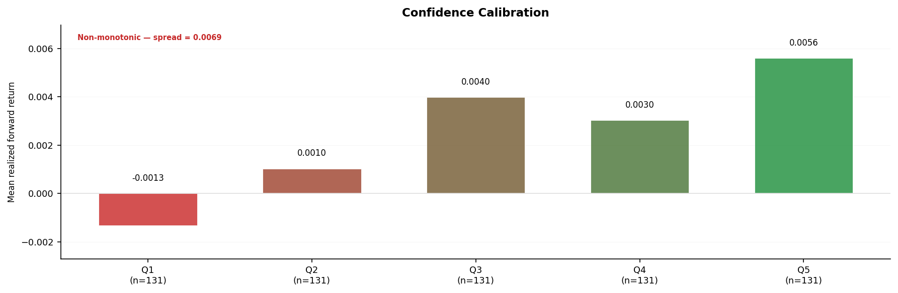

*Mean realized forward return by prediction-score quintile (Q1 = lowest to Q5 = highest). A left-to-right increasing pattern confirms that score magnitude carries economic information — higher-confidence predictions correspond to stronger realized returns. Non-monotonic patterns flag calibration failure and indicate that equal-weight allocation may dominate confidence-weighted schemes in this experiment.*

## ML Model Behaviour

**Predictive quality:**

| Metric | Value |
| --- | --- |
| Positive-IC ranking periods (full period) | 57.7% |
| Mean monthly cross-sectional IC | 0.0841 |
| % months with positive cross-sectional IC | 69.7% |
| Model-fitting observations (post-NaN removal) | 55,360 |


### Cross-Sectional Ranking Geometry

The following diagnostics expose the statistical geometry of the cross-sectional ranking system — measuring prediction dispersion, score discrimination, realized economic separation, and ranking stability. Together they reveal when the model had genuine cross-sectional conviction and when ranking became arbitrary.

| Metric | Value |
| --- | --- |
| Mean cross-sectional score IQR | 0.0301 |
| Min score IQR (most compressed regime) | 0.0136 |
| Mean top-bottom score spread | 0.0463 |
| Mean realized spread (top − bottom, pre-cost) | 0.225% (positive) |
| Fraction of periods with positive realized spread | 72% |
| Mean monthly rank autocorrelation | 0.827 |
| Fraction of months with positive rank persistence | 98% |

Score IQR remained above its minimum throughout (mean 0.0301, min 0.0136). The model maintained measurable cross-sectional separation across regimes.

Mean rank autocorrelation 0.83 — rankings were highly persistent. The model's ordering of assets was stable across consecutive rebalance periods, consistent with a momentum-driven hypothesis. 98% of monthly transitions had positive rank autocorrelation.

Realized top-bottom spread averaged 0.22% per period (72% of periods positive) — the model's score ranking corresponded to economic outcome separation over this horizon. This is a pre-cost gross spread; execution costs and market impact reduce the realisable advantage.

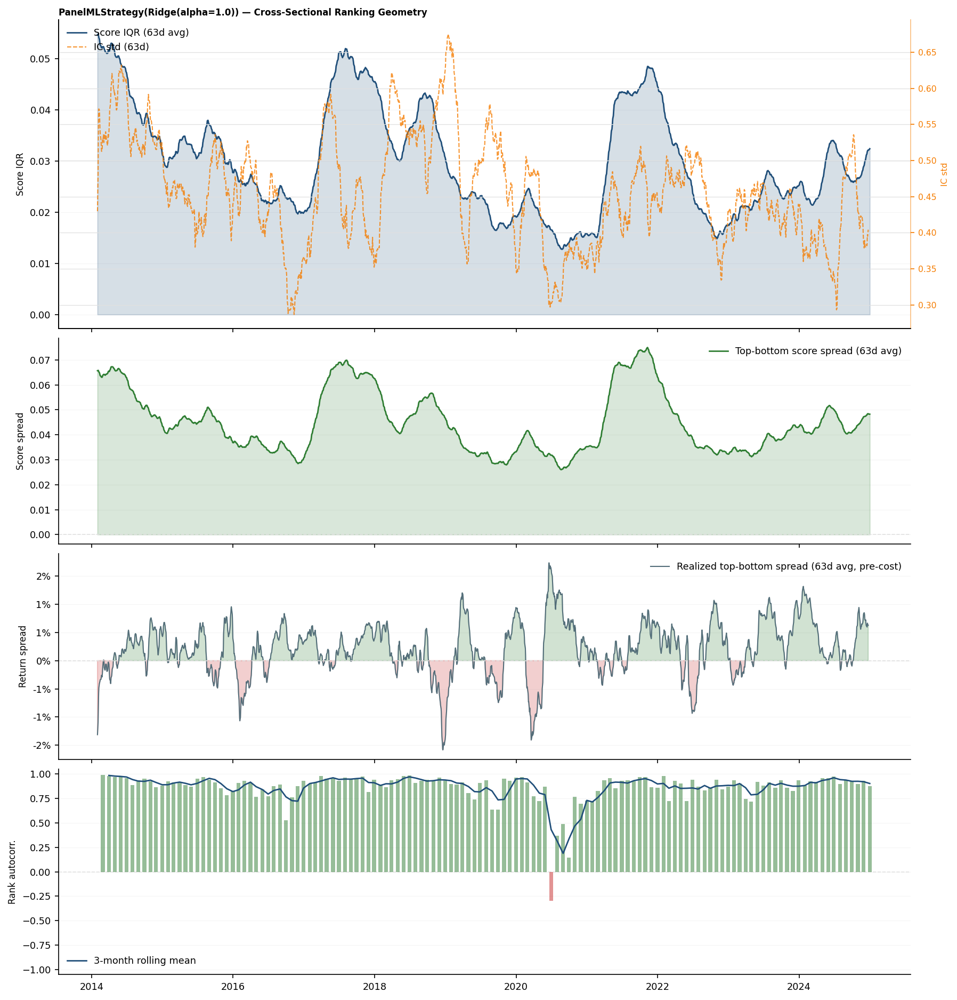

*Cross-sectional ranking geometry: prediction dispersion (score IQR) and IC instability (IC std, right axis); score discrimination (top-minus-bottom spread); realized return discrimination; and monthly rank autocorrelation. Periods of simultaneous IQR compression and elevated IC std identify regimes of compressed-but-erratic ranking — the most diagnostically significant failure state for a cross-sectional model.*


### Prediction Confidence & Outcome Monotonicity

Assets are ranked by predicted cross-sectional score on each monthly rebalance date and assigned to top, mid, or bottom thirds (~6 assets per group). Realized 5-day forward returns are evaluated per group across 131 monthly observations. Monotonic ordering — top group outperforming bottom — confirms that prediction magnitude, not merely sign, carries cross-sectional economic content.

| Prediction Group | Mean 5D Realized Return |
| --- | --- |
| Top group (highest scores) | 0.515% |
| Mid group | 0.305% |
| Bottom group (lowest scores) | -0.102% |
| Long-short spread (top − bottom) | 0.617% |

Realized return ordering is **monotonic** (top > mid > bottom). Score magnitude carries economically meaningful cross-sectional information: the model's ranking conviction corresponds to realized outcome strength.

The 5D long-short spread between top and bottom groups is 0.62% (positive). This is a pre-cost gross spread diagnostic, not a realisable strategy return. It quantifies the raw ranking discrimination of the signal before portfolio construction, transaction costs, and execution frictions.

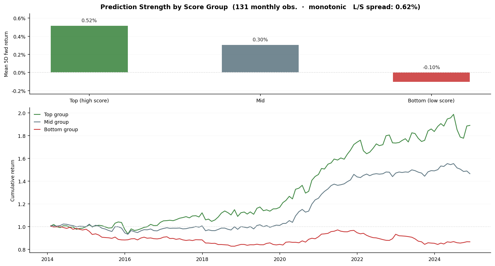

*Top panel: mean 5-day realized forward return by prediction score group (131 monthly observations, ~6 assets per group). Monotonic left-to-right ordering is the ML legitimacy diagnostic. Bottom panel: cumulative return of each prediction group over time. Persistent group separation confirms durable signal strength; convergence marks regimes of prediction-strength collapse.*


**Feature importance summary** (sorted by sign consistency):

| Feature | Full-period coef | Mean OOS coef | Sign consistency |
| --- | --- | --- | --- |
| 60D Momentum | -0.2752 | -0.3750 | 100% |
| 20D Z-Score | -0.0058 | -0.0079 | 100% |
| 60D Market Beta | +0.0285 | +0.0217 | 100% |
| 63D Risk-Adj Momentum | +0.0267 | +0.0393 | 100% |
| 252D Momentum | +0.0836 | +0.0731 | 86% |
| 20D Momentum | +0.1271 | +0.1066 | 71% |
| 63D Breakout Strength | +0.1707 | +0.2125 | 71% |
| Vol Compression (21/63D) | -0.0025 | -0.0036 | 71% |
| 126D Risk-Adj Momentum | +0.0002 | -0.0005 | 71% |
| 252D Risk-Adj Momentum | +0.0003 | +0.0006 | 71% |
| 5D Momentum | -0.0610 | -0.0207 | 57% |
| 21D Realized Volatility | +0.0032 | +0.0129 | 57% |
| 20D Trend Strength | -0.0006 | -0.0050 | 57% |
| 20D Trend Persistence | -0.0061 | +0.0068 | 57% |
| 252D Drawdown Distance | -0.0302 | +0.0204 | 57% |

*Full-period coef is from the model fitted on all data; mean OOS coef is the average across walk-forward splits. Divergence between the two indicates regime-specific learning — the full-period model captures structure the walk-forward splits did not consistently reproduce.*


*Sign consistency is the fraction of walk-forward splits where the coefficient's sign matches the sign of its mean. Values near 1.0 indicate a stable directional signal; values near 0.5 indicate noise.*

### Temporal Feature Contribution

Feature contribution measures realised predictive influence: coefficient × standardised feature value at each date. Unlike static coefficient tables, contribution captures when each feature was activated, suppressed, or inverted — exposing how the model's internal predictive structure evolved through time.

| Diagnostic | Value |
| --- | --- |
| Dominant family (by contribution share) | Trend (100% of periods) |
| Family leadership transitions | 2 |
| Mean contribution concentration (HHI) | 0.602 — concentrated (one family dominates) |
| Most temporally volatile feature | 60D Momentum |

The **Trend** family dominated predictions in 100% of periods, indicating the model's cross-sectional ranking signal was concentrated in a single predictive hypothesis for most of the backtest. This is characteristic of a momentum-regime environment where trend information dominates.

Contribution structure was stable and concentrated — 2 family leadership transitions across the backtest — consistent with a model that operated in persistent predictive regimes rather than frequently adapting.


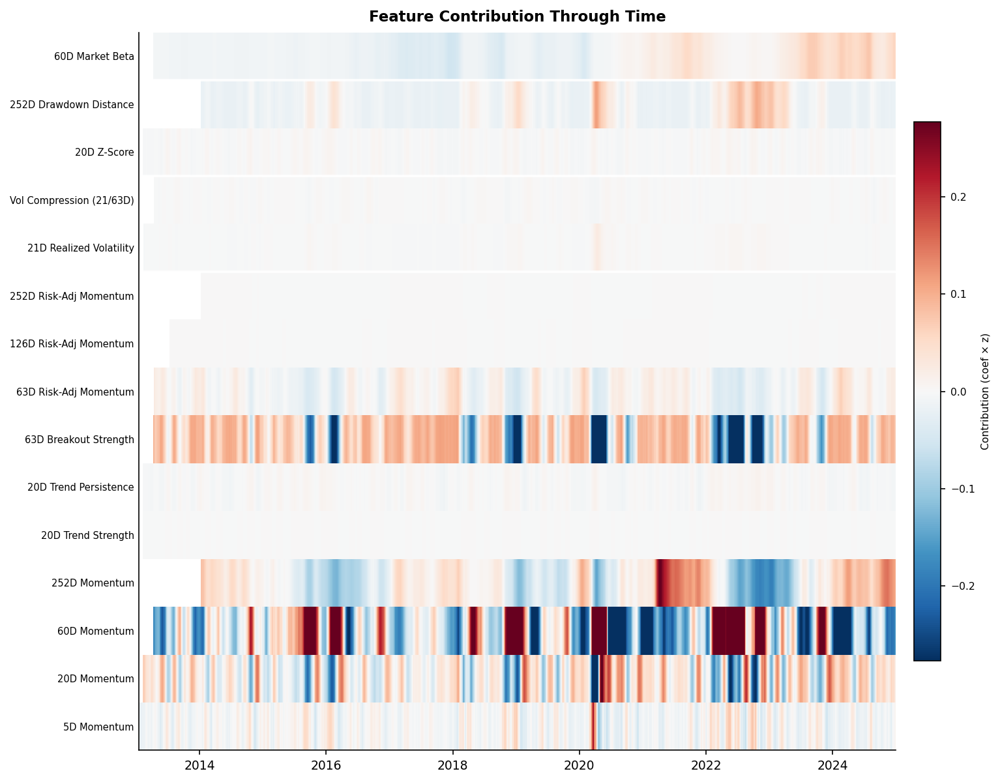

*Feature contribution heatmap: realised predictive influence (coefficient × standardised feature value) for each feature through time, grouped by family. Red = positive contribution (feature state predicts above-average cross-sectional return); blue = negative. Family separators mark hypothesis boundaries. Regime shifts appear as horizontal band colour transitions; simultaneous sign changes across a family reveal coordinated hypothesis activation or suppression. Contribution shown using panel reference-ticker feature values scaled by the shared panel coefficient vector.*

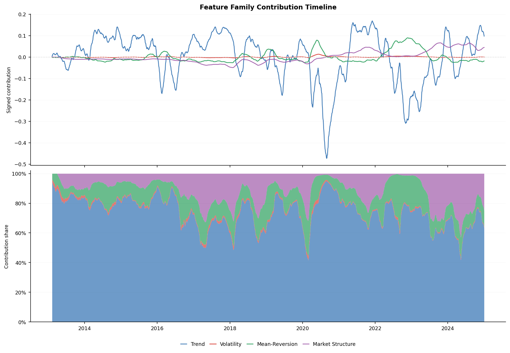

*Feature family contribution timeline. Top panel: signed rolling family contributions — shows which hypothesis family drove predictions and in which direction. Persistent positive contributions indicate an actively reinforcing family; negative contributions indicate the family is working against the dominant direction. Bottom panel: normalised absolute contribution share — shows family dominance through time regardless of sign. Regime shifts appear as share transitions between families.*

### Regime-Conditional Feature Behaviour

The 7 walk-forward test windows are classified into high-volatility (3 splits) and low-volatility (4 splits) regimes using median cross-asset 21D realised volatility as threshold. This classification exposes conditional cross-sectional IC behaviour — which feature families provided signal under stressed vs calm conditions.

| Feature Family | High-Vol Mean IC | Low-Vol Mean IC | Differential |
| --- | --- | --- | --- |
| Trend | +0.008 | -0.002 | +0.010 |
| Volatility | +0.010 | +0.047 | -0.037 |
| Mean-Reversion | -0.009 | -0.028 | +0.019 |
| Market Structure | +0.051 | +0.102 | -0.051 |

The **Market Structure** family provided the strongest cross-sectional IC in both volatility regimes, indicating a regime-persistent directional hypothesis. The IC differential across regimes reveals the degree of regime sensitivity within this dominant family.

**Trend** reversed sign between regimes — positive cross-sectional IC in one environment became negative in the other. Sign reversals indicate regime-specific learning, not a stable directional relationship. **Market Structure** shows the largest regime sensitivity (differential -0.051), contributing stronger in low-vol splits.


## Performance Metrics

| Metric | Value |
| --- | --- |
| Annualized Return | 0.1112 |
| Annualized Volatility | 0.1740 |
| Sharpe Ratio | 0.6932 |
| Max Drawdown | -0.3291 |
| Calmar Ratio | 0.3378 |
| Hit Rate | 0.4930 |

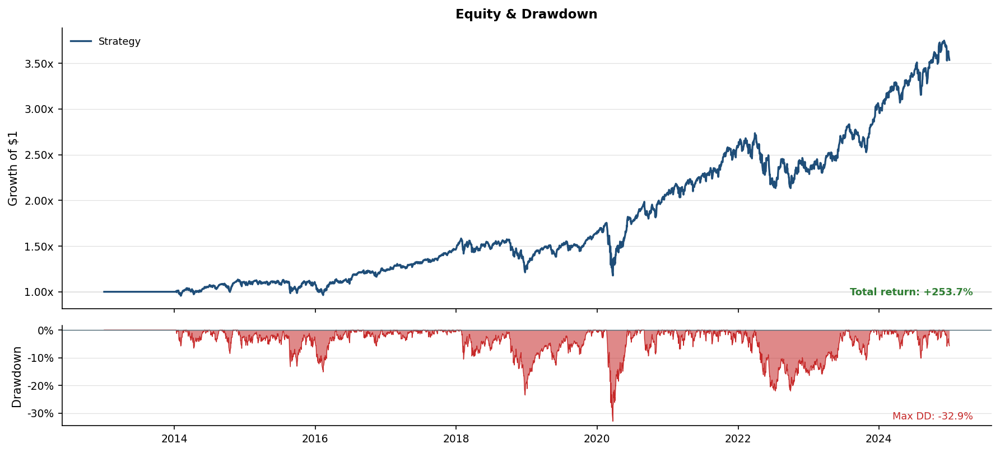

*Max drawdown -32.9% — severe. Sharpe 0.69. Slow recovery indicates signal-edge loss, not random noise.*

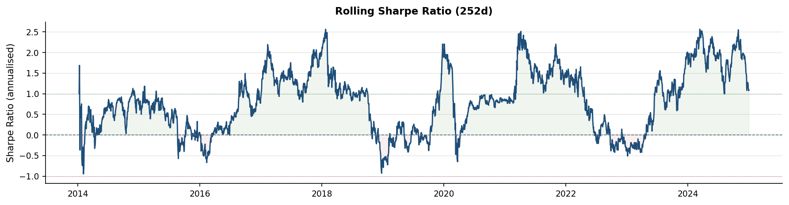

*Extended sub-zero periods mark sustained underperformance episodes. Rolling Sharpe variance is as diagnostically informative as its mean.*

## Walk-Forward Validation

Chronological rolling validation: each test window immediately follows its training window in calendar time, with no overlap. This is the only leakage-safe simulation of live deployment — the model is never tested on data from periods it could have seen during training.

**Validation type:** `rolling`

| Parameter | Value |
| --- | --- |
| retrain_frequency_days | 30 |
| step_months | 12 |
| test_months | 12 |
| train_months | 48 |

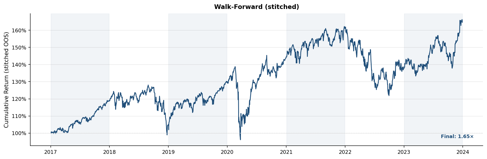

*Concatenated OOS test segments in chronological order. Consistent segment slopes across different market regimes confirm structural alpha. Persistent growth through stress periods is the strongest evidence of generalisation.*

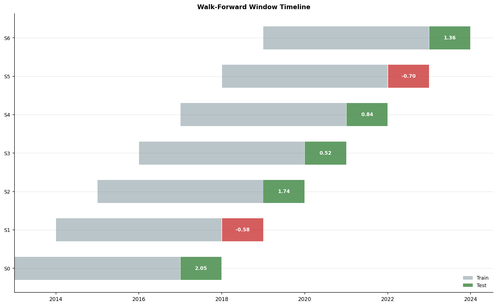

*Train/test windows in calendar time with OOS Sharpe annotated. Green test bars are positive-Sharpe splits; red are negative. Window widths reflect the configured train and test lengths.*

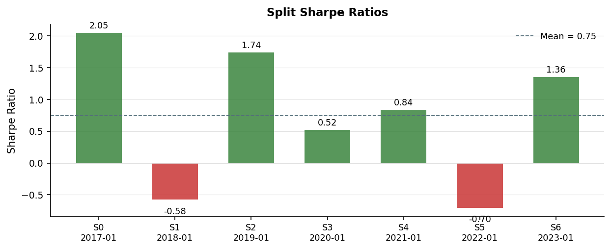

*Per-split OOS Sharpe distribution. High variance across splits indicates regime-dependent performance; a single outlier inflating the mean is a key failure mode.*

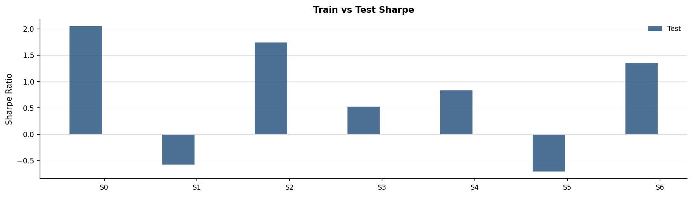

*Mean OOS Sharpe 0.75 across 7 splits (positive, 71% positive). Large per-split gaps mark regime-specific overfitting.*

## Failure Analysis

**Failure analysis — ML signal:**

*Out-of-sample verdict:* RidgeRegression demonstrates robust out-of-sample performance: 5 of 7 test windows were positive (mean OOS Sharpe: 0.75).

**Known failure modes for ML price-history strategies:**

- *Regime non-stationarity* — Feature-return relationships shift across macro regimes (risk-on/risk-off, trending/mean-reverting, high/low volatility). A model trained on 2013–2016 data learns relationships that may not hold in 2022 tightening cycles or 2020 dislocation episodes. Mean cross-sectional IC of 0.084 confirms ranking signal exists in aggregate, but sub-period IC variation (visible in the IC chart) reveals regime dependence.
- *Feature instability* — `mom_5`, `vol_21`, `trend_20`, `trend_persist_20d` show sign consistency below 60% across walk-forward splits, indicating their directional contribution reverses in different training regimes. The model is learning regime-specific patterns, not persistent market relationships.
- *Overfitting on training regime* — Ridge regularisation constrains but does not eliminate overfitting risk. Large train-to-test Sharpe gaps in specific splits are the diagnostic signature of regime-specific learning.
- *Cross-sectional dispersion collapse* — In low-dispersion regimes where all assets trend together, the cross-sectional model has little return differentiation to exploit. The top-N signal concentrates in whichever assets have marginally higher scores, but all scores are clustered — the effective information content drops.
- *Transaction cost drag from universe rotation* — Holding the top-N assets requires full rebalancing when the composition changes. In regimes of high score volatility, turnover rises sharply and cost drag erodes signal value.

**Instability propagation:**

Coefficient sign reversals in 5D Momentum, 21D Realized Volatility, 20D Trend Strength indicate the model learned regime-specific rather than structural relationships. IC is consistently positive (70% of periods, mean 0.0841), propagating coefficient instability into signal degradation. Positive-IC rate (57.7%) is above random; instability in learned feature weights propagates into cross-sectional ranking errors that reach portfolio returns.

**Identified drawdown windows (> 5% peak-to-trough):**

| Drawdown Start | Trough | Recovery | Max DD | Duration |
| --- | --- | --- | --- | --- |
| 2020-02-24 | 2020-03-23 | 2020-06-01 | -32.9% | 98d |
| 2018-10-10 | 2018-12-24 | 2019-04-26 | -23.4% | 198d |
| 2022-04-21 | 2022-09-30 | 2023-06-08 | -22.0% | 413d |

**Worst out-of-sample split:**

- Split 5 — test period 2022-01-03 to 2022-12-30
- Sharpe: -0.70
- Return: -14.4%
- Max DD: -24.7%

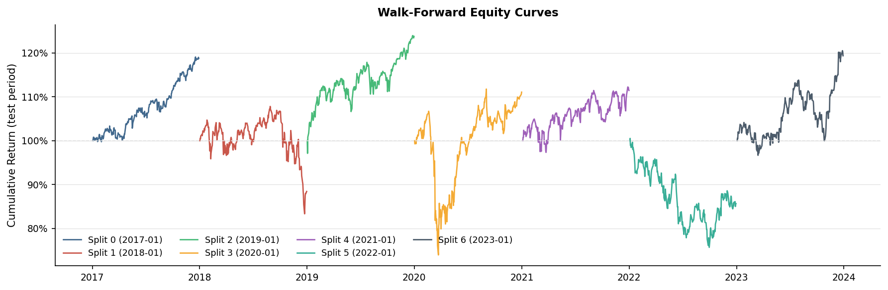

*Divergent split trajectories identify regimes where the signal broke down. Consistent slopes across periods indicate regime-independent alpha.*

## Diagnostics Appendix

Detailed diagnostics for walk-forward validation and ML signal quality.

### Walk-Forward Stability

| Metric | Value |
| --- | --- |
| Splits | 7 |
| Mean Sharpe | 0.7456 |
| Std Sharpe | 1.0765 |
| Positive-Sharpe rate | 71.4% |
| Mean annualised return | 8.38% |
| Mean max drawdown | -15.33% |
| Worst max drawdown | -30.71% |

### ML Signal Diagnostics

| Metric | Value |
| --- | --- |
| Avg daily turnover | 0.0798 |
| Signal activity | 91.5% |

## Metadata

| Field | Value |
| --- | --- |
| Experiment | `showcase_20etf_ridge_rar5d_top5_rt30_rb5` |
| Strategy | `PanelMLStrategy(Ridge(alpha=1.0))` |
| Created | 2026-06-13T18:59:03.783927+00:00 |

## Configuration

**Universe:** SPY, QQQ, IWM, EFA, EEM, TLT, IEF, AGG, HYG, LQD, GLD, DBC, VNQ, XLK, XLF, XLE, XLV, XLI, XLP, XLU

**Date range:** 2013-01-01 to 2024-12-31

**Strategy type:** `ML / RidgeRegression`

**Transaction cost:** 5.0 bps
**Validation:** `rolling`

## Figures

### Ml Information Coefficient

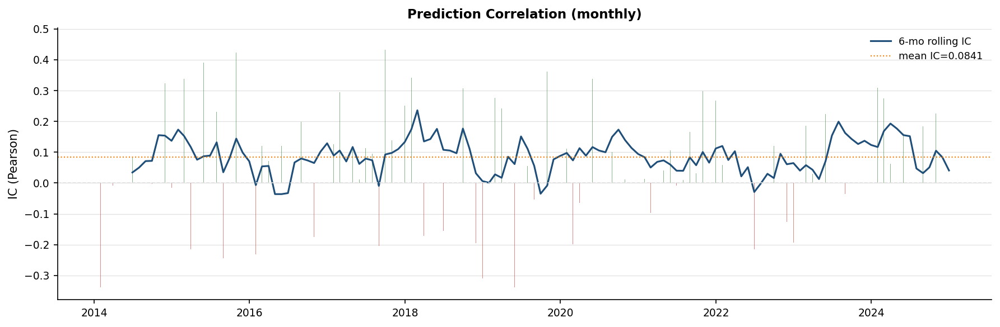

*Monthly rolling information coefficient (Pearson correlation of predicted vs actual returns). Persistent positive IC confirms the model adds directional information beyond chance.*

### Ml Prediction Distribution

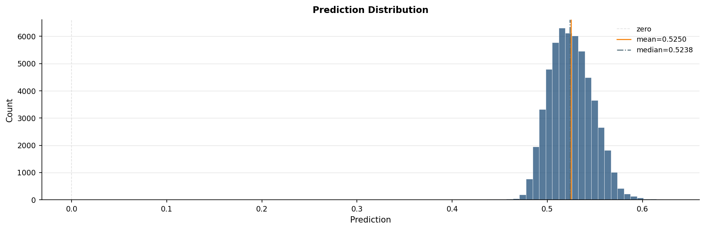

*Distribution of raw model predictions. Near-symmetric distributions centred near zero indicate a well-calibrated model without directional drift or label leakage.*

### Coefficient Stability Analysis

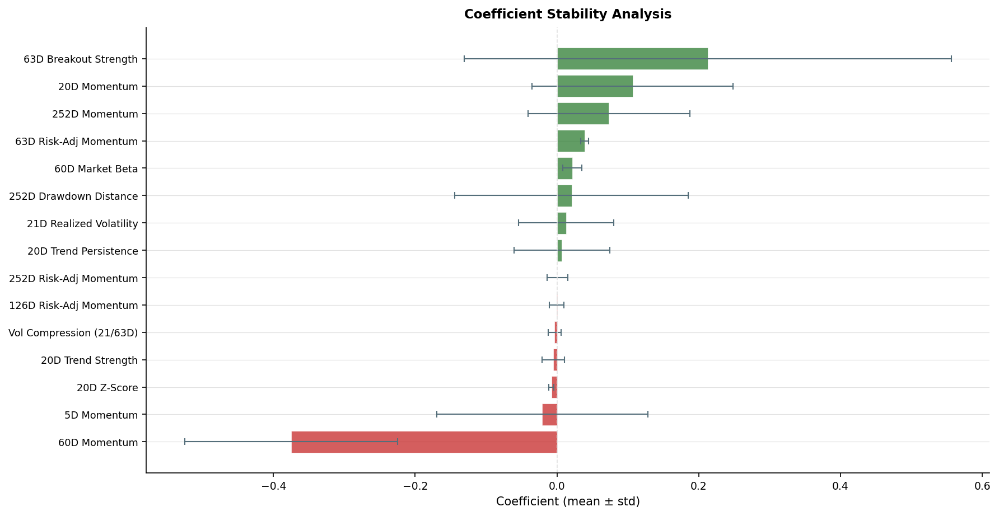

*Mean ± std of model coefficients across walk-forward splits. Bars with consistent sign and similar magnitude confirm a stable, replicable learned relationship.*

### Coefficient Evolution Across Walk-Forward Splits

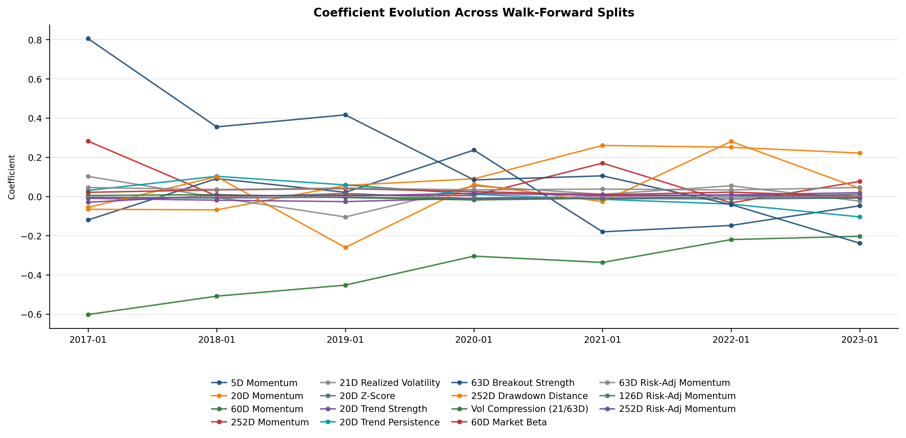

*Coefficient trajectory across walk-forward splits (chronological). Stable features maintain consistent sign and magnitude; unstable features cross zero, indicating regime-dependent learning.*

### Feature Regime Evolution

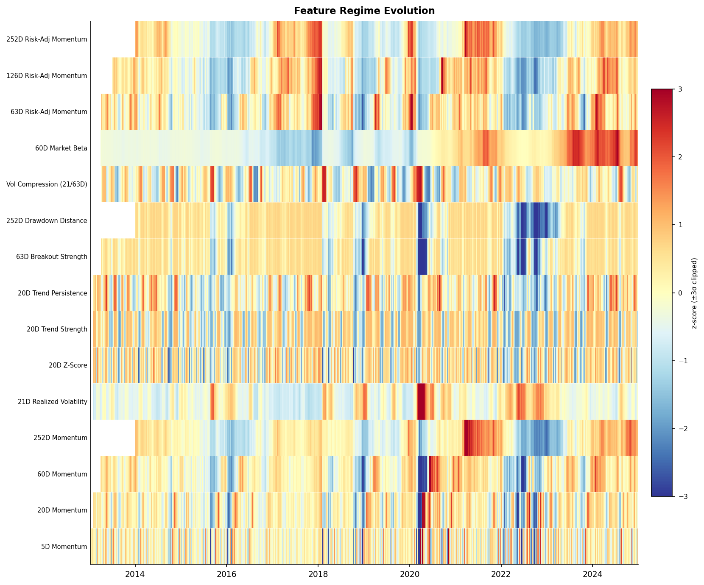

*Feature z-score heatmap (±3σ). Red marks periods of extreme positive feature values; blue marks extreme negative. Reveals feature regime transitions and co-movement across the backtest period.*

### Rolling Cross-Sectional Information Coefficient

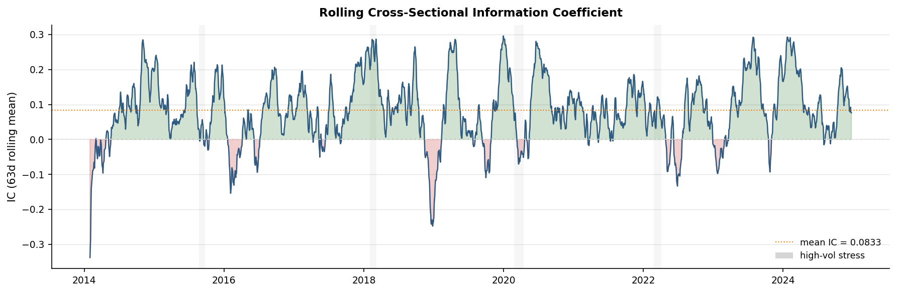

*63-day rolling mean cross-sectional IC through time. Green fill marks sustained periods of positive IC; red marks signal breakdown. Width of each regime reveals persistence vs transience.*

### Rolling Ranking Accuracy

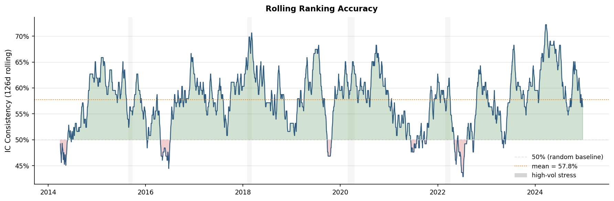

*126-day rolling IC consistency: fraction of days with positive cross-sectional IC. Values above 0.50 indicate the model ranks assets correctly more often than not; below 0.50 marks signal degradation.*

### Coefficient Sign Consistency by Walk-Forward Split

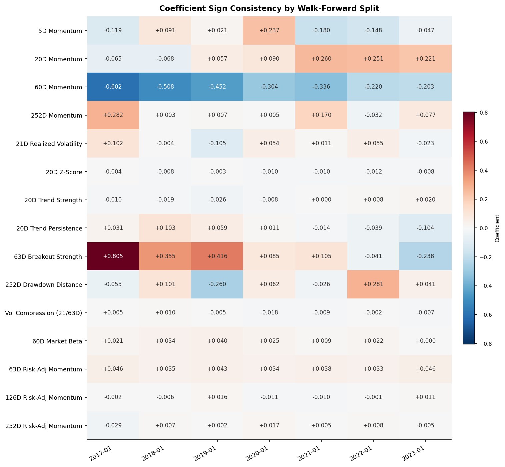

*Coefficient values across walk-forward splits (x-axis) and features (y-axis). Blue = negative, red = positive; saturation encodes magnitude. Colour changes across splits reveal sign reversals and regime-specific learning.*

### Feature Information Coefficient by Walk-Forward Split

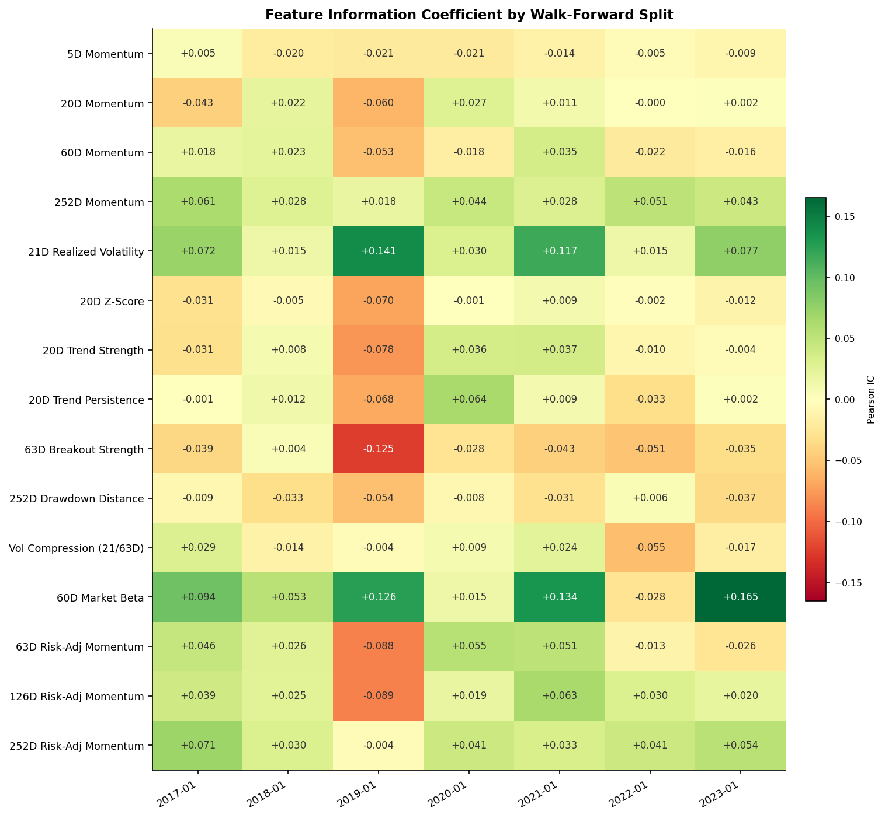

*Per-feature IC against test-period labels by walk-forward split. Green = positive predictive IC; red = negative. Reveals which features drove signal quality in which regimes and where individual features broke down.*

### Feature Family Information Coefficient by Walk-Forward Split

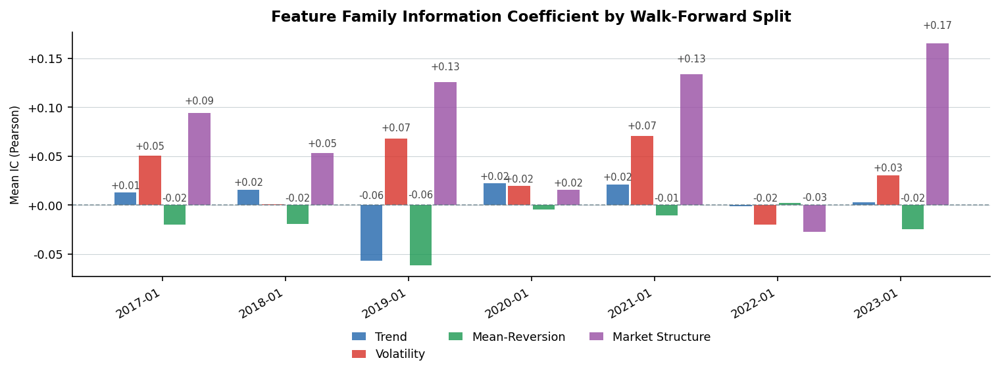

*Mean IC aggregated by feature family across walk-forward splits. Grouped bars reveal which hypothesis families (Trend, Volatility, Mean-Reversion, Market Structure) provided net positive signal in each regime and which degraded.*

### Regime-Conditional Feature Information Coefficient

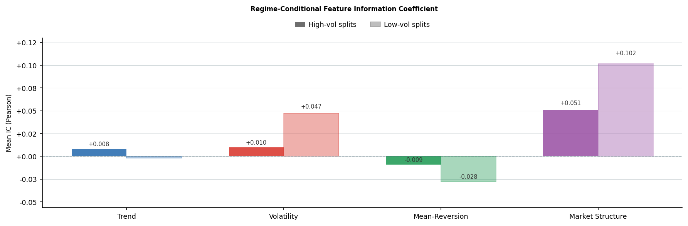

*Feature family mean IC disaggregated by volatility regime. Each family shows two bars: high-volatility test splits (solid) vs low-volatility test splits (faded). Reveals which feature families provided signal preferentially under stressed vs calm market conditions. The vol regime classification uses the median cross-asset 21D realised vol across walk-forward test windows as the threshold.*

### Prediction Dispersion


*Prediction dispersion — rolling score IQR (filled, left axis) and rolling IC standard deviation (dashed, right axis). Low IQR with high IC std identifies compressed-but-erratic regimes where the model assigns similar scores but the IC is volatile.*

### Score Discrimination

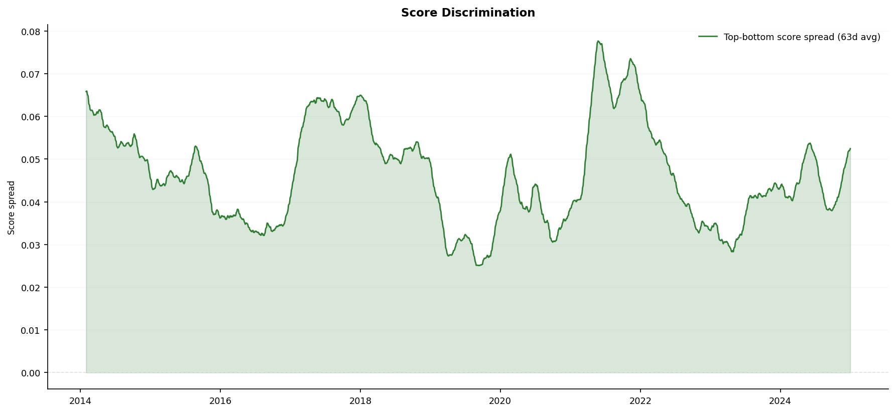

*Score discrimination — rolling top-vs-bottom score spread (63d avg). Near-zero values indicate the model assigns similar scores to the highest and lowest ranked assets, making allocation effectively arbitrary.*

### Realized Return Discrimination

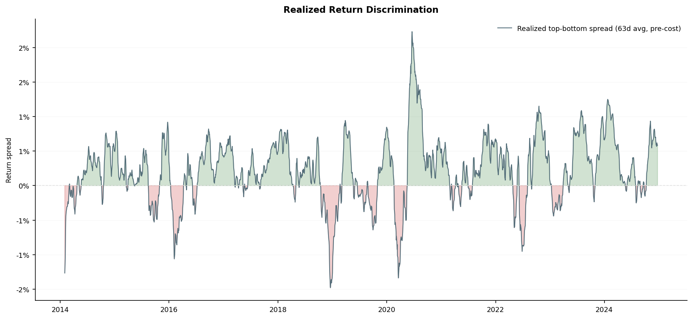

*Realized discrimination — rolling realized forward-return spread between top and bottom ranked groups (63d avg, pre-cost gross). Economic confirmation of whether score separation translates to outcome separation. Green fill = positive spread; red = reversal.*

### Ranking Persistence

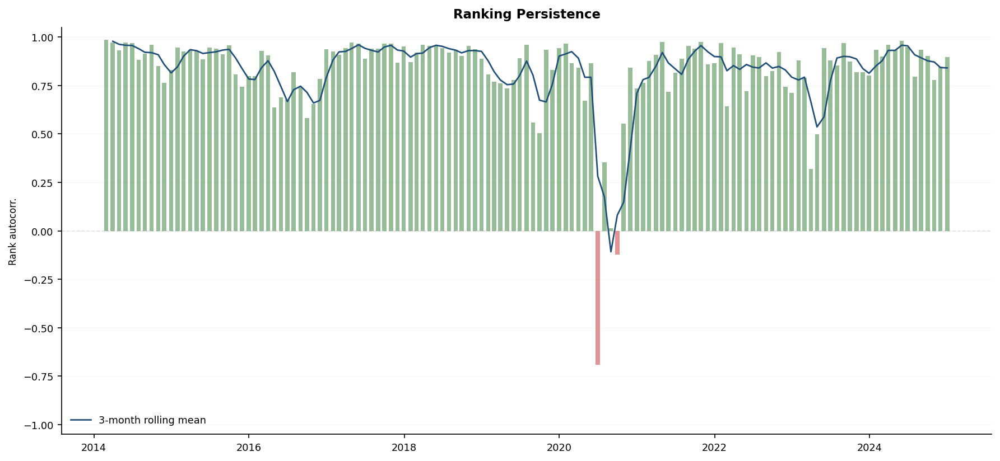

*Rank persistence — monthly Spearman autocorrelation of asset score rankings. High values indicate stable model convictions; near-zero marks regimes where rankings flip arbitrarily each rebalance, amplifying turnover without informational content.*

### Cross-Sectional Information Coefficient

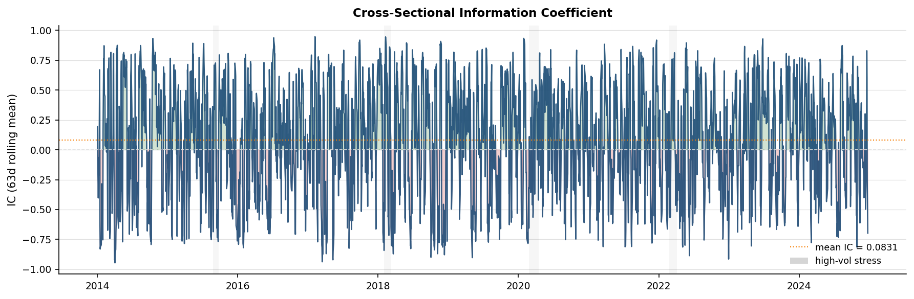

*Daily cross-sectional Spearman IC: Spearman rank correlation between predicted scores and realized returns across all assets per date. Persistent positive values confirm the model correctly ranks assets in the cross-section.*

## Provenance

| Key | Value |
| --- | --- |
| ML hash | `985b0a6e9d22` |

> **Publication Consistency Notes**
> 
> ⚠️ **[family_ic_absent]** Experiment has 4 active feature families but no 'feature_family_ic' figure was generated. Run with walk-forward validation to produce family IC diagnostics.
> ⚠️ **[feature_ic_figure_absent]** feature_ic_by_split data is present in ml_model_diagnostics but no 'feature_ic_heatmap' figure was generated.

---

Report version: 1
Generated: 2026-06-13T19:00:47.119463+00:00
Source experiment: showcase_20etf_ridge_rar5d_top5_rt30_rb5